# Rapport du projet Couteau suisse

8 novembre 2026 · Loick

Le Couteau suisse est en ligne sur mon conteneur cs01 (192.168.1.143). J'y ai monté cinq outils auto-hébergés derrière un portail unique, un login Authelia et du HTTPS, le tout accessible via `alltools.lan`.

## Pourquoi ce projet

Je voulais remplacer des services en ligne par des outils que j'héberge moi-même. Cinq raisons m'y ont poussé.

- **Open source.** Les cinq outils sont libres (GPL-3.0, AGPL-3.0 ou MIT, voir l'annexe). Le code est public, je peux le vérifier, et il n'y a aucun abonnement à payer.
- **Local.** Tout tourne sur mon serveur, dans le conteneur `cs01`, sur mon réseau. Je n'ai besoin d'aucun compte chez un fournisseur pour m'en servir.
- **Souveraineté des données.** Mes fichiers, mon budget et mes accès restent chez moi. Je décide qui y accède, où tout est stocké et quand je supprime.
- **Pas de publicités ni de traqueurs.** Les outils gratuits en ligne vivent souvent de la pub et du suivi des visiteurs. Les miens s'exécutent chez moi, sans service tiers imposé. Stirling-PDF, par exemple, se présente comme un outil qui traite les PDF sans les envoyer à des services externes.
- **Documents et infos confidentiels en local.** Les PDF à signer ou à compresser, mon budget personnel et les fichiers de mes machines ne sortent pas de mon réseau. L'accès passe par un login unique et du HTTPS.

En contrepartie, la maintenance m'incombe : mises à jour, sauvegardes et sécurité.

## Résumé

Je voulais un portail web unique qui regroupe des outils auto-hébergés et redirige vers le bon conteneur, sur une machine Proxmox minimale. C'est en place : le portail, le login, le HTTPS, le DNS local et les cinq outils retenus (les lignes bleues de ma page Notion) fonctionnent, et la page de statut affiche les six services « en ligne ».

| Élément | État |
| --- | --- |
| Conteneur cs01 (LXC Ubuntu, 2 CPU, 4 Go de RAM, 39 Go de disque) | En service, IP 192.168.1.143 |
| Docker et 8 containers (nginx, Authelia, statut, 5 outils) | En service |
| Login unique Authelia sur tous les sous-domaines | Fonctionne |
| HTTPS avec certificat auto-signé, installé comme certificat de confiance sur le PC | Fonctionne |
| DNS local (dnsmasq) pour `alltools.lan` | Fonctionne, réglé sur le PC seulement |
| Page portail avec statut en direct | Fonctionne |

## Architecture

L'utilisateur passe par un portail nginx (login et reverse proxy), qui l'envoie vers un conteneur par outil. Le schéma de ma page Notion prévoyait une VM de 7 Go de RAM pour 11 services. Avec les cinq outils que j'ai gardés, un conteneur plus petit suffit.

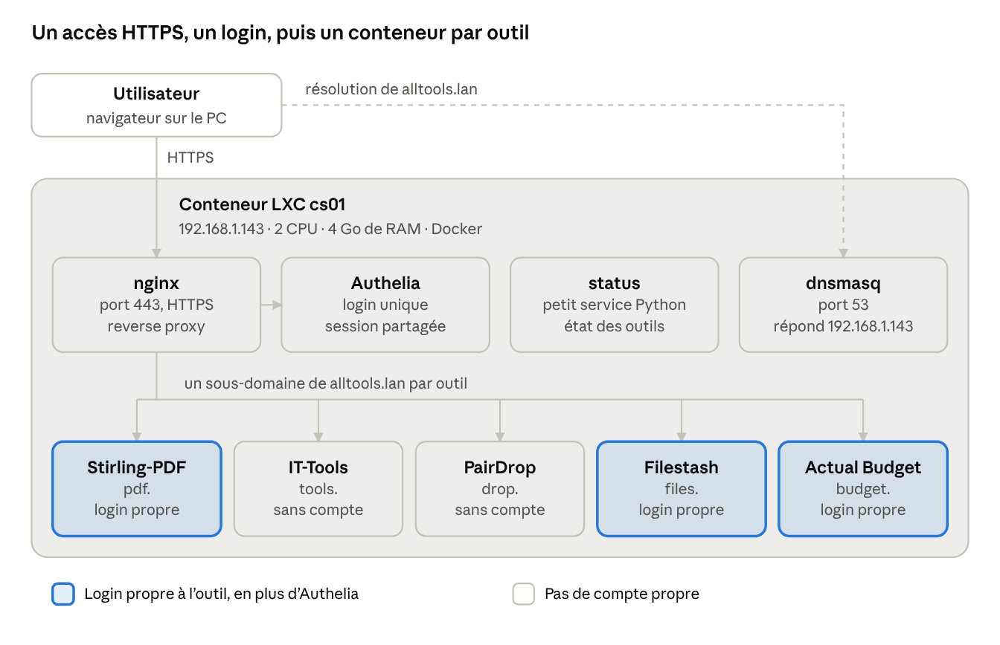

*Architecture installée. Tout passe par nginx en HTTPS, Authelia vérifie la session, puis chaque sous-domaine mène à son conteneur. Mon schéma d'origine prévoyait 11 services dans une VM de 7 Go, je n'ai installé que les cinq outils retenus.*

Source : ma page Notion « Projet Couteau suisse ». J'ai retenu les lignes en surbrillance bleue du tableau.

| Outil | Rôle | Projet |
| --- | --- | --- |
| Stirling-PDF | Fusion, découpe, compression, signature, OCR | Stirling-Tools/Stirling-PDF |
| IT-Tools | Dizaines d'utilitaires et calculateurs | CorentinTh/it-tools |
| PairDrop | Partage de fichiers sur le réseau local | schlagmichdoch/PairDrop |
| Filestash | Accès web aux fichiers d'une machine (SMB, SFTP, FTP) | mickael-kerjean/filestash |
| Actual Budget | Suivi de budget personnel, synchronisé | actualbudget/actual |

J'ai dimensionné le conteneur d'après une estimation de mémoire, que je n'avais pas mesurée au départ :

| Composant | RAM estimée |
| --- | --- |
| Système et Docker | 400 Mo |
| nginx et Authelia | 50 Mo et environ 100 Mo |
| IT-Tools, PairDrop, Filestash, Actual | 20, 100, 150 et 200 Mo |
| Stirling-PDF (plafonné à 1 Go de Java) | 1 à 1,5 Go |
| **Total en pointe** | **environ 2,3 Go** |

Mes principaux choix techniques :

- Un sous-domaine par outil (`pdf`, `tools`, `drop`, `files`, `budget`), parce qu'Actual, Filestash et PairDrop gèrent mal un chemin du genre `/outil`.
- Authelia pour un seul login partagé entre tous les sous-domaines. Il exige du HTTPS.
- Un conteneur LXC non privilégié plutôt qu'une VM, pour consommer moins de mémoire.

## Déroulé de l'installation

J'ai créé le conteneur `cs01` sur le nœud Proxmox `pve-02` (Proxmox VE 7.4). Les étapes suivent l'ordre réel.

1. **Création du conteneur** : LXC Ubuntu non privilégié, 2 CPU, 4 Go de RAM, 512 Mo de swap, disque de 39 Go.
2. **Réglages** : j'ai activé Nesting et keyctl pour Docker, fixé l'IP à `192.168.1.143` et mis le DNS sur `1.1.1.1`.
3. **Installation de Docker** avec le script officiel (version 29.9.3).
4. **Contournement de `runc`** : j'ai passé le profil AppArmor du conteneur en `unconfined` côté hôte, puis supprimé le paquet `apparmor` dans le conteneur. Après ça, `hello-world` s'exécute.
5. **Envoi du projet** `couteau-suisse` dans `/root` du conteneur.
6. **Préparation** : certificat auto-signé (`gen-cert.sh`), fichier `.env` avec trois secrets aléatoires, hash de mon mot de passe Authelia écrit dans `authelia/users_database.yml`.
7. **Démarrage** avec `docker compose up -d` : sept containers au premier lancement, puis un huitième (`status`) pour la page de statut.
8. **Accès depuis mon PC** : d'abord le fichier `hosts`, puis le certificat dans ma chaîne de confiance, puis le DNS local.

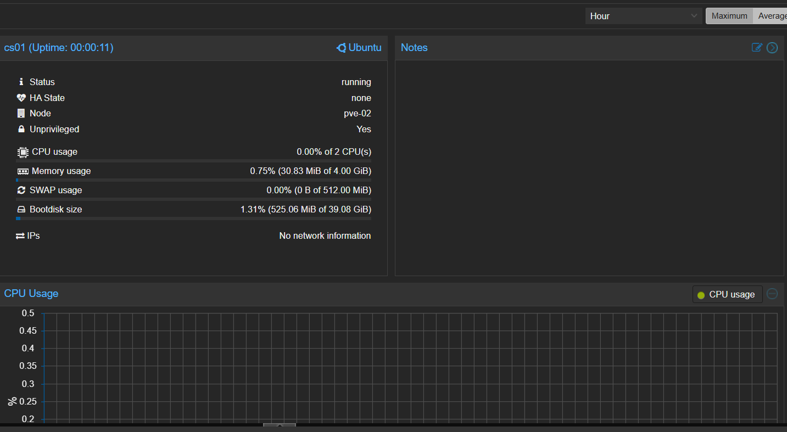

*Mon conteneur cs01 dans Proxmox : 2 CPU, 4 Go de RAM, 512 Mo de swap, disque de 39 Go, nœud pve-02 (étape 1).*

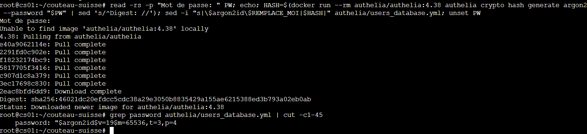

*Le hash de mon mot de passe Authelia est écrit dans le fichier. Le téléchargement de l'image Authelia s'affiche au passage (étape 6).*

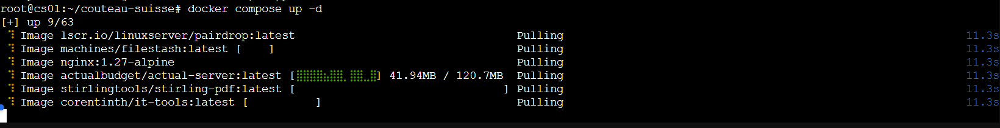

*Premier `docker compose up -d` : téléchargement des images (étape 7).*

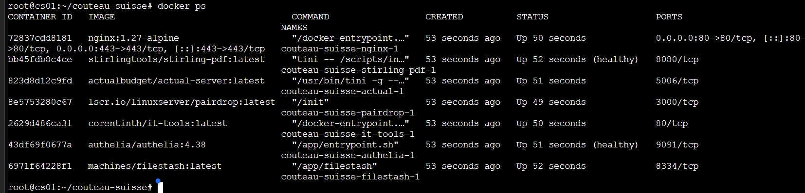

*Les sept containers tournent, Authelia et Stirling-PDF sont « healthy ».*

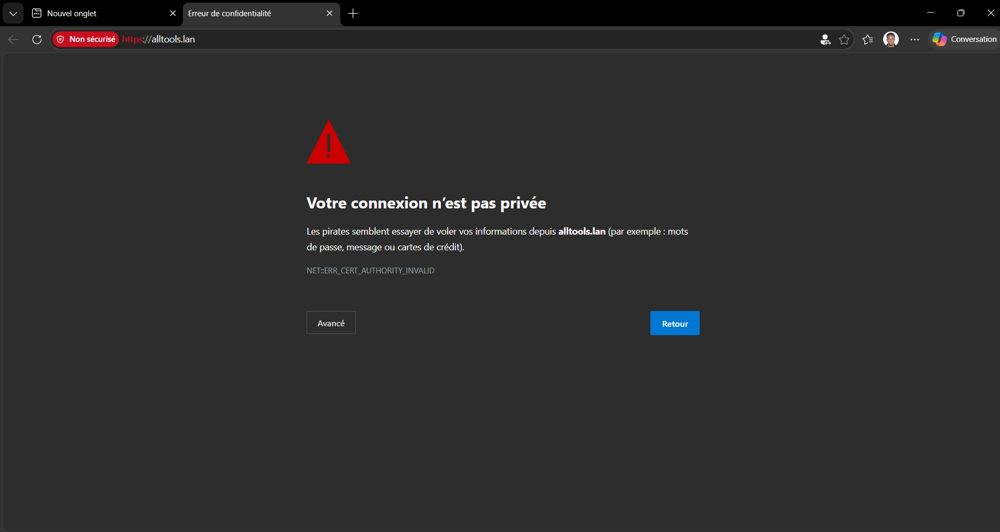

*Premier accès : l'avertissement est normal avec un certificat auto-signé. Je l'ai installé comme certificat de confiance juste après (étape 8).*

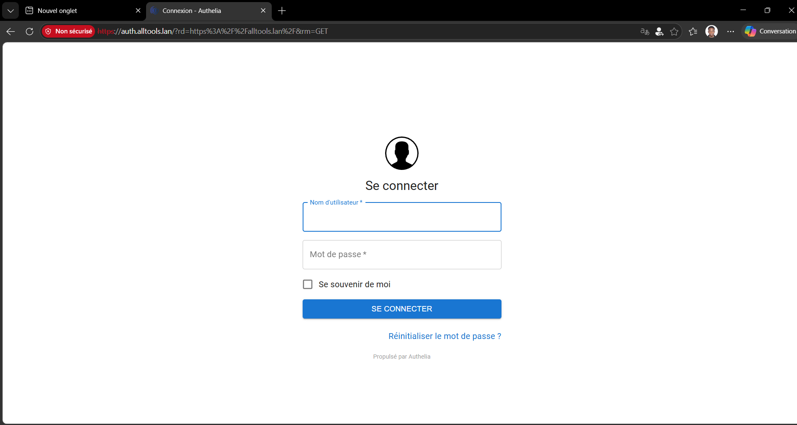

*Le portail me redirige vers `auth.alltools.lan` et la page de connexion Authelia s'affiche. La chaîne nginx et Authelia fonctionne.*

## Erreurs rencontrées et corrections

Quatre problèmes sont apparus pendant l'installation de Docker et le transfert du projet. Je les ai tous corrigés ou contournés.

| # | Symptôme | Cause | Correction |
| --- | --- | --- | --- |
| 1 | `hello-world` : `runc … net.ipv4.ip_unprivileged_port_start: permission denied` | Docker récent dans un LXC non privilégié | Voir lignes 2 et 3 |
| 2 | Mise à jour de l'hôte impossible (timeouts, IPv6 « Network is unreachable ») | Réseau instable depuis l'hôte ; Proxmox VE 7.4 n'est plus supporté | Mise à jour abandonnée, rien n'a été installé ; ajout de `lxc.apparmor.profile: unconfined` à la config du conteneur |
| 3 | Docker : lecture de `/sys/kernel/security/apparmor/profiles` refusée | Profil AppArmor devenu `unconfined` | `apt purge apparmor` dans le conteneur, puis redémarrage de Docker |
| 4 | `tar : Cannot change ownership to uid 197609` | Propriétaire Windows de l'archive, refusé par un LXC non privilégié | Sans gravité ; `--no-same-owner` et `chown -R root:root` ensuite |

## Les 5 outils testés

J'ouvre chaque outil depuis une tuile du portail, avec le même login Authelia.

| Outil | Adresse | Login propre | Remarque |
| --- | --- | --- | --- |
| Stirling-PDF | `pdf.alltools.lan` | Oui | Identifiants par défaut à changer à la première connexion |
| IT-Tools | `tools.alltools.lan` | Non | Fonctionne sans compte |
| PairDrop | `drop.alltools.lan` | Non | L'appareil apparaît sous un nom aléatoire |
| Filestash | `files.alltools.lan` | Oui | Mot de passe admin à créer, backend LOCAL à vérifier |
| Actual Budget | `budget.alltools.lan` | Oui | Budget de démonstration affiché au départ |

Côté SSO, Authelia protège déjà l'accès à tous les outils. Stirling, Filestash et Actual me demandent quand même une seconde connexion. Je n'ai pas mis en place le SSO complet par OpenID Connect, c'est un choix que j'ai fait.

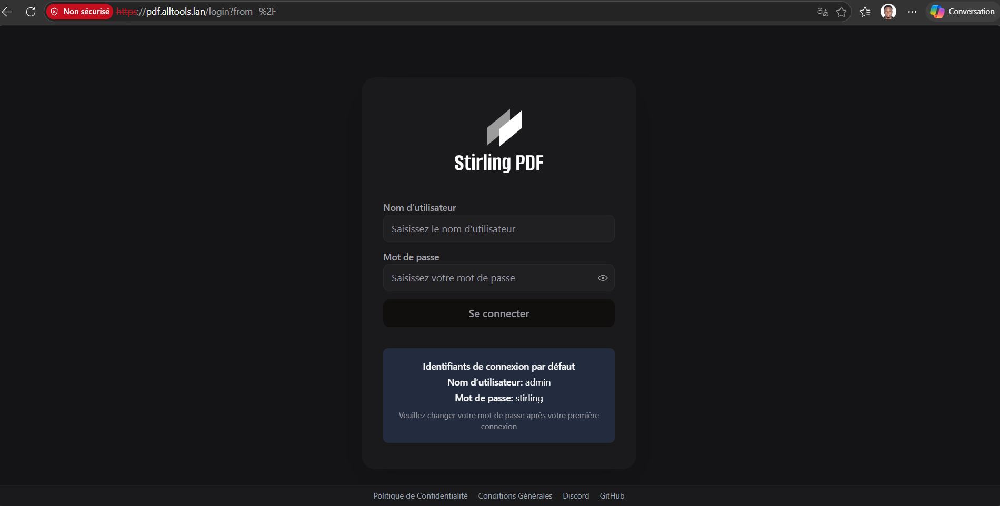

*Stirling-PDF : page de connexion propre à l'outil, avec les identifiants par défaut affichés.*

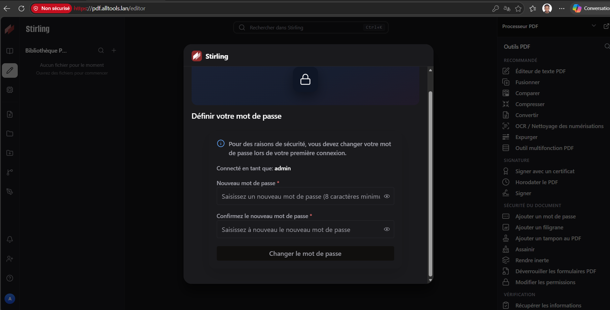

*Stirling-PDF : à la première connexion, un nouveau mot de passe est exigé ; l'éditeur et les outils PDF apparaissent derrière.*

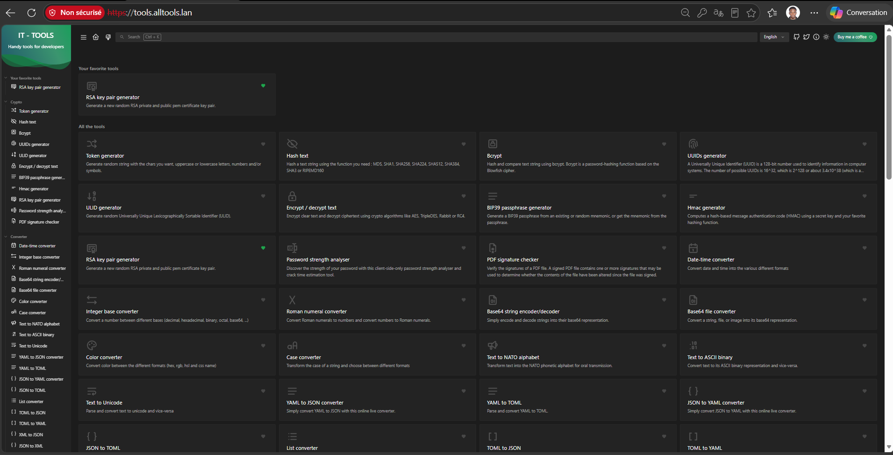

*IT-Tools : une grille d'utilitaires, sans compte.*

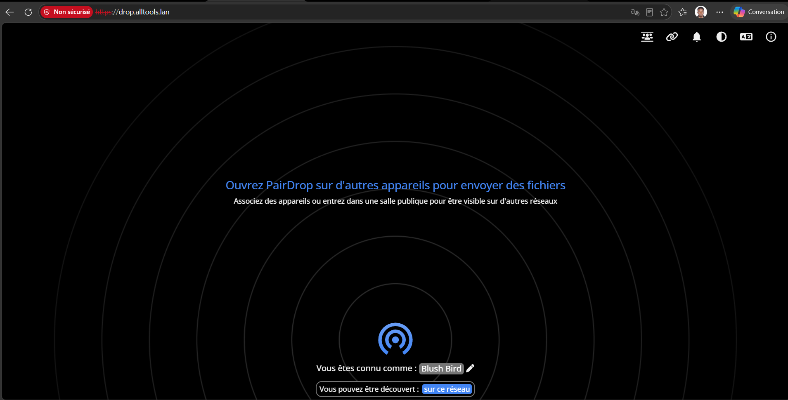

*PairDrop : l'appareil est visible sur le réseau sous un nom aléatoire.*

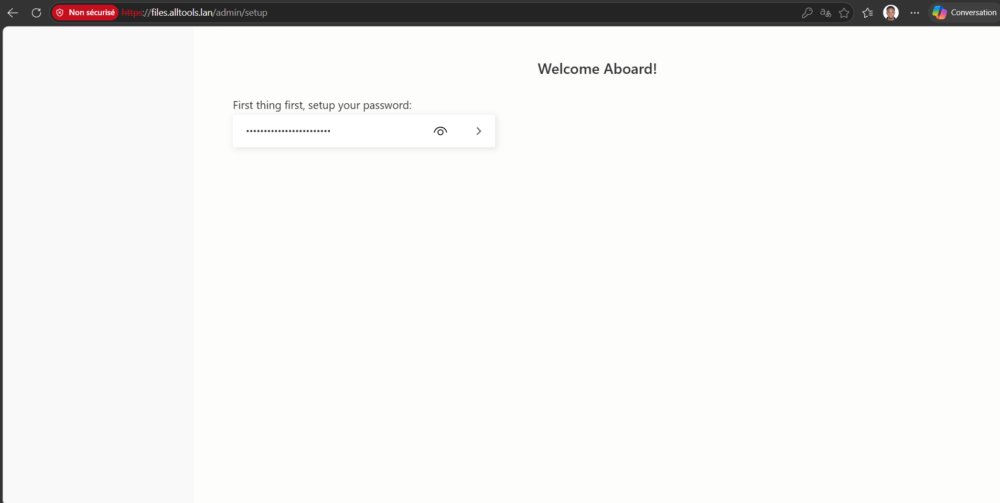

*Filestash : première étape, la création du mot de passe d'administration.*

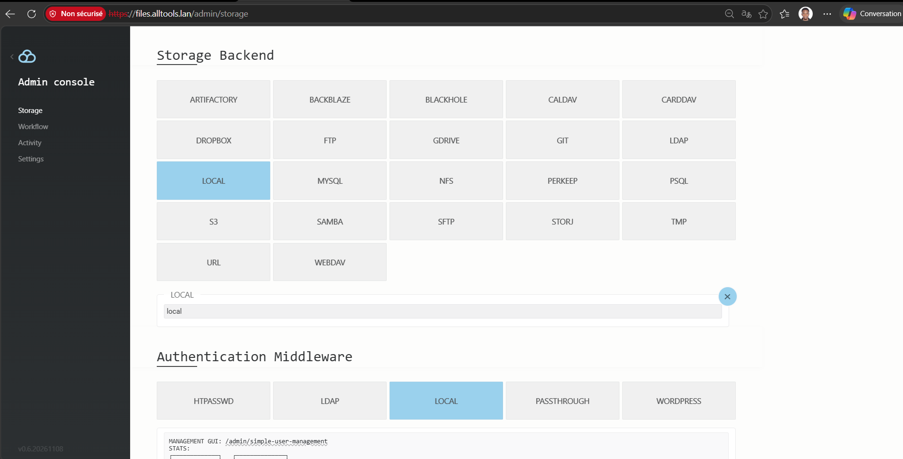

*Filestash : console d'administration avec la liste des backends de stockage ; LOCAL est sélectionné.*

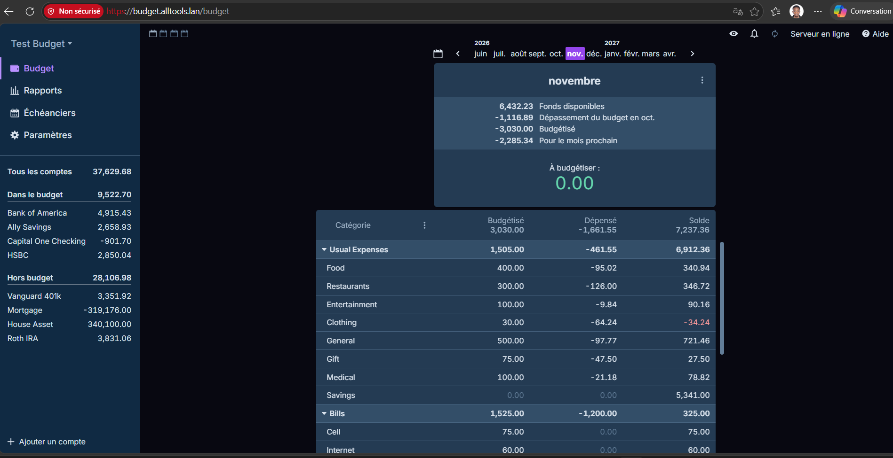

*Actual Budget : le budget de démonstration, avec ses catégories et ses comptes.*

## Le portail

La page d'accueil est un nginx statique placé derrière le login Authelia. Elle affiche l'heure, l'IP du serveur, l'état de chaque outil avec son temps de réponse, des jauges CPU, mémoire et disque, mes raccourcis personnels et un bloc-notes.

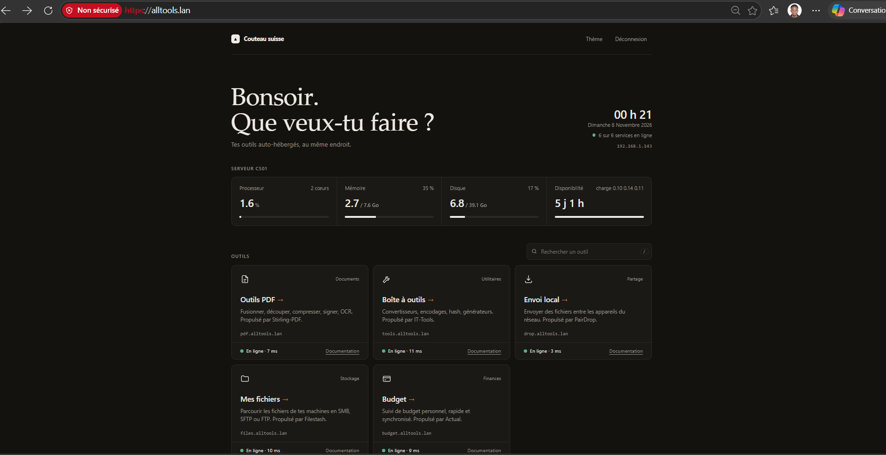

*Page d'accueil : « 6 sur 6 services en ligne », temps de réponse par outil et jauges du serveur.*

Le design suit les principes de [Taste Skill](https://www.tasteskill.dev/) pour un écran d'application :

- une seule palette (papier chaud, encre, un accent terre cuite), sans dégradé violet ni texte en dégradé ;
- un titre en serif, aligné à gauche, et des chiffres alignés ;
- des panneaux sobres sans ombres, la couleur réservée aux données (pastille verte ou rouge, jauge rouge à 90 %) ;
- vérifié à 1440, 768 et 390 pixels : pas de défilement horizontal, marges de 20 px minimum.

Les statuts viennent d'un petit service Python (`status`, environ 64 Mo) que nginx interroge derrière le login.

## DNS local et certificat

**Certificat.** `gen-cert.sh` crée un certificat auto-signé valable cinq ans pour `alltools.lan` et `*.alltools.lan`. Une fois installé dans ma chaîne de confiance sous Windows, le navigateur affiche le cadenas. Sur un autre appareil ou dans Firefox, il faudra l'installer séparément.

**DNS.** Un container `dnsmasq` (Alpine, dossier `/root/dns`) répond `192.168.1.143` pour tout nom en `alltools.lan` et renvoie le reste vers `1.1.1.1` et `1.0.0.1`. Je publie son port 53 sur l'IP du conteneur seulement, pour éviter un conflit avec le DNS interne d'Ubuntu.

- `nslookup pdf.alltools.lan 192.168.1.143` renvoie `192.168.1.143` ;
- j'ai ensuite nettoyé le fichier `hosts` de mon PC ;
- j'ai réglé le DNS de mon PC à la main sur la carte Wi-Fi (préféré `192.168.1.143`, auxiliaire `192.168.1.1`).

Je n'ai pas encore réglé le DNS du routeur, donc mes autres appareils ne trouvent pas `alltools.lan`.

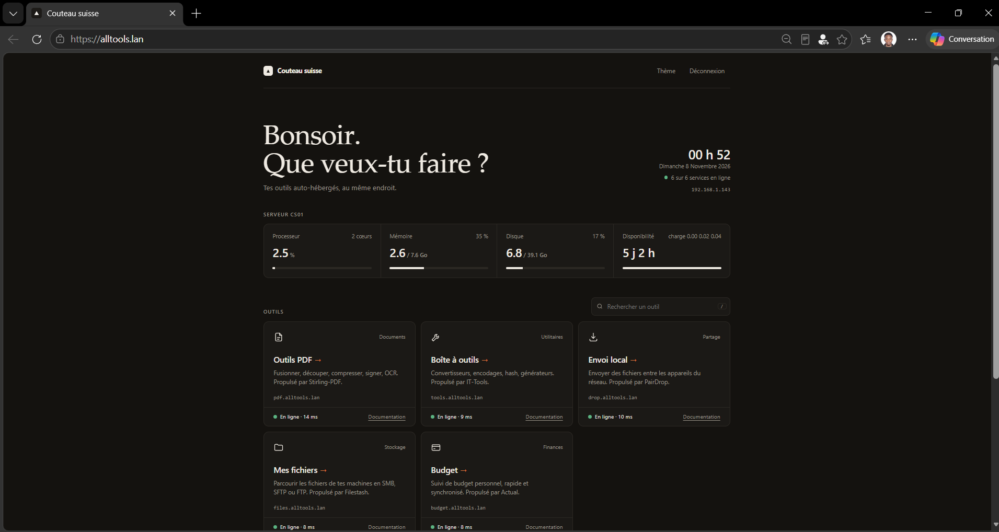

*Portail en HTTPS, sans avertissement après l'installation du certificat de confiance.*

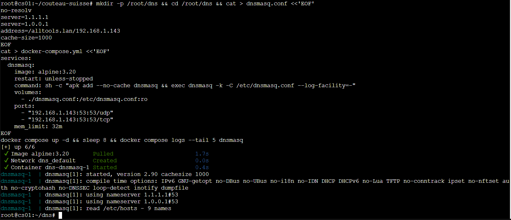

*Le container dnsmasq démarre : version 2.90, serveurs de repli 1.1.1.1 et 1.0.0.1.*

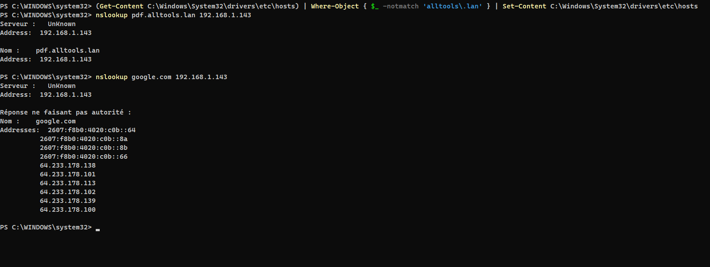

*`nslookup` : `pdf.alltools.lan` renvoie 192.168.1.143 et google.com est résolu via ce DNS.*

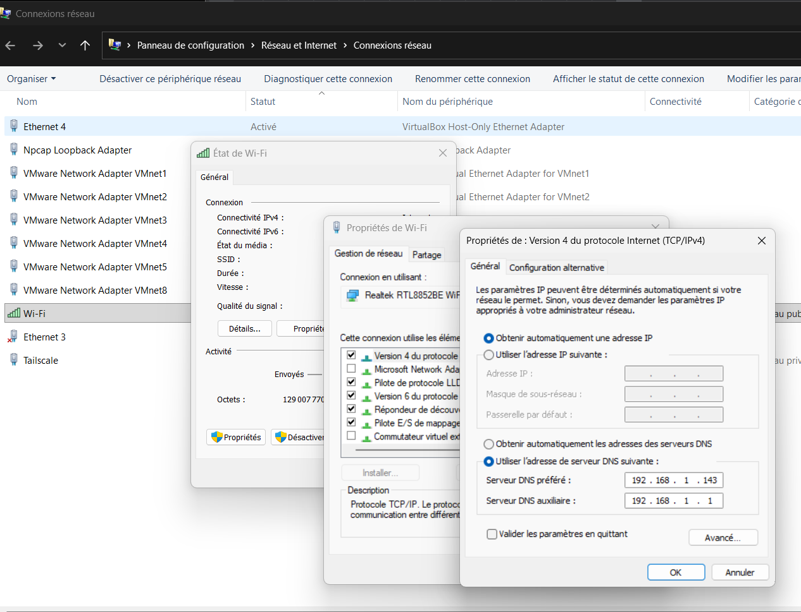

*Réglage Windows : DNS préféré 192.168.1.143, DNS auxiliaire 192.168.1.1.*

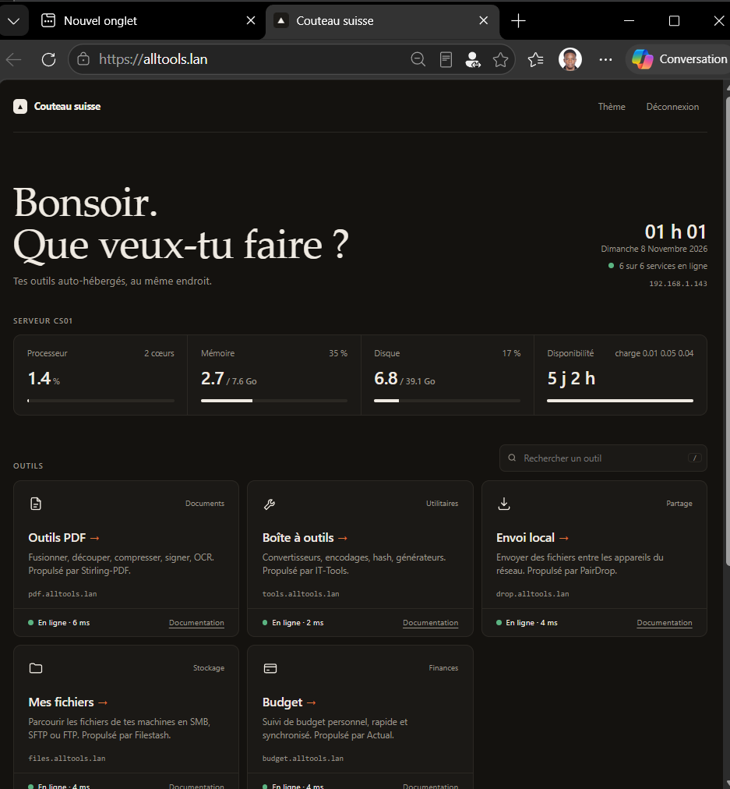

*Le portail s'ouvre sur `https://alltools.lan` via le DNS local : 6 sur 6 services en ligne.*

## Fichiers du projet et commandes utiles

Tout est dans `/root/couteau-suisse` sur cs01 (le DNS est dans `/root/dns`). Pour récupérer le projet :

```bash
git clone https://github.com/ordinotech/couteau-suisse.git
```

| Fichier | Rôle |
| --- | --- |
| `docker-compose.yml` | nginx, Authelia, status et les 5 outils |
| `nginx/conf.d/default.conf` | Un bloc par sous-domaine, protégé par Authelia |
| `nginx/snippets/` | Proxy commun, vérification Authelia |
| `authelia/configuration.yml` et `users_database.yml` | Login et utilisateur |
| `portal/index.html` | Page d'accueil du portail |
| `status/status.py` | Statut des outils et stats du serveur |
| `dns/` | dnsmasq pour `alltools.lan` |
| `gen-cert.sh`, `.env` | Certificat et secrets |

Commandes courantes, depuis `/root/couteau-suisse` :

```bash
docker compose ps
docker compose logs --tail 20 nginx authelia status
docker compose restart nginx
docker compose up -d
```

La configuration nginx n'est relue qu'au redémarrage de `nginx`. Un changement de `portal/index.html` est visible après rechargement de la page.

## Annexe : les projets retenus

Pages GitHub des cinq outils, capturées avant l'installation.

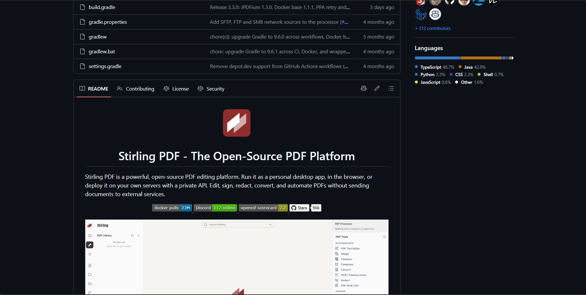

*Stirling-PDF : plateforme PDF open source.*

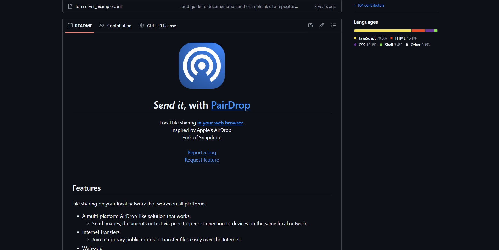

*PairDrop : partage de fichiers local, licence GPL-3.0.*

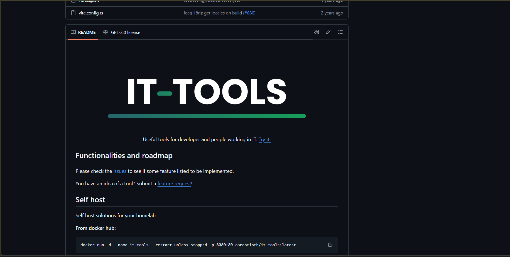

*IT-Tools : utilitaires pour développeurs, image Docker `corentinth/it-tools`.*

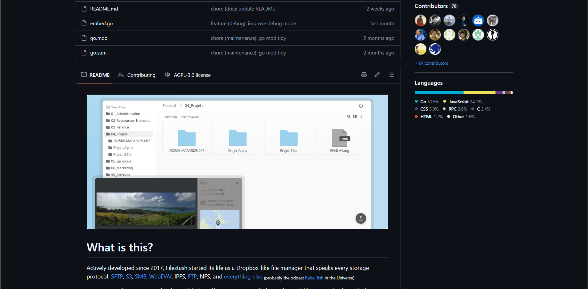

*Filestash : gestionnaire de fichiers pour SFTP, S3, SMB, WebDAV, FTP, licence AGPL-3.0.*

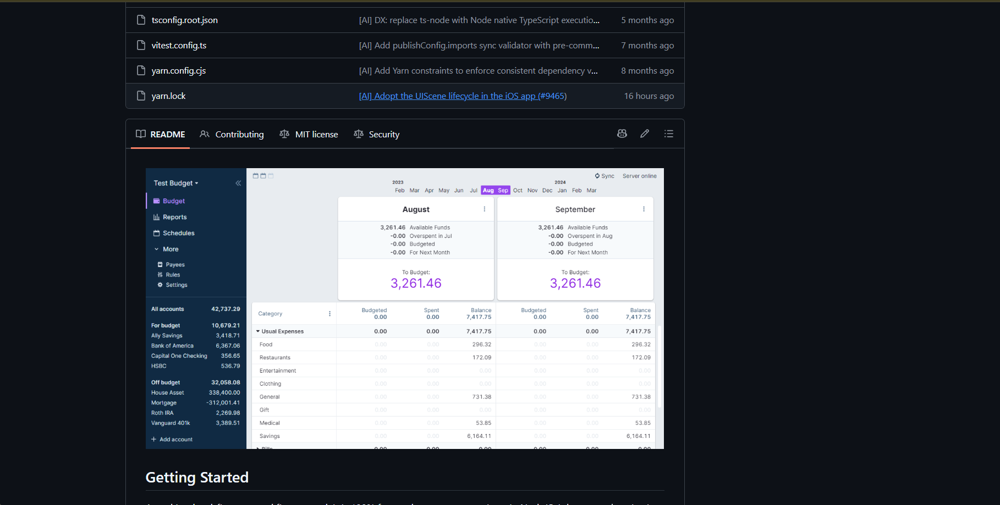

*Actual Budget : suivi de budget personnel, licence MIT.*

## Licence

Ce dépôt est sous licence [MIT](LICENSE). Les outils installés gardent chacun leur propre licence.
